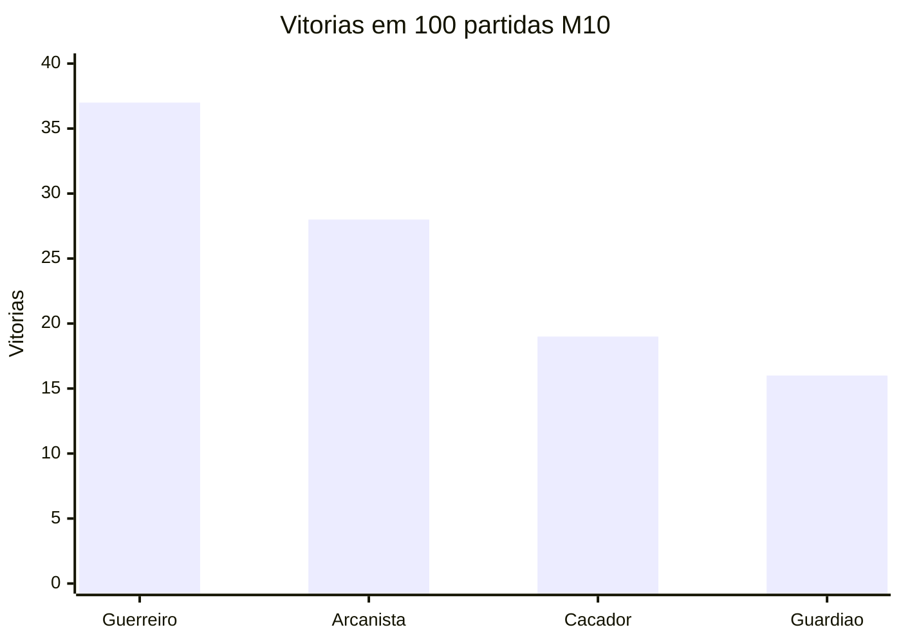

# V5 — 100 partidas M10 com builds variadas (30/10/2026)

**Escopo:** laboratório sintético isolado da branch `feature/v5-arena-dos-criadores`. Nenhuma integração com alunos, XP, turmas, notas, aprovações ou `main`.

## Execução verificável
- Script: `qa/v5-balance-100-m10.cjs`, blob SHA `b6c60870caeabd77ec6a187a1d99cc266b443756` (commit `d7302d7cee9382a3a69280fdd64607f1817ad461`).
- Motor: `v5/phase2-combat.js`, blob SHA `8c5422baa9cde3260f1a5250fae4d29b1533b2c5`.
- **Executado de fato** em V8 isolado com o código desses dois arquivos obtido do GitHub; duração de execução ~36,6 segundos. Não confundir com GitHub Actions: o CI desta revisão **não pôde ser confirmado** (sem checks/PR runs retornados pelas consultas).
- 100 batalhas completas: 25 com quatro participantes e 75 com trinta; dez talentos únicos e vinte pontos por personagem; atributos e escolhas de talentos embaralhados por seed reprodutível; 120/120 talentos **selecionados ao menos uma vez**, não necessariamente ativados.
- Configuração: `arenaMission:10`, `arenaScale:5`, `damageScale:.5`, `stormDelay:35`, `stormRateFactor:.65`, `engagementMode:'spaced'`, `navigationMode:'steer'`, `rangedCommitment:'recovery'`, `balancePreset:'e-hp2'`. Escalas experimentais de escudo G01/G10 **não ativadas**.

## Vitórias por classe

| Classe | 4 participantes (25 partidas) | 30 participantes (75 partidas) | Total (100) | Expectativa por participação | Participações |
|---|---:|---:|---:|---:|---:|
| Guerreiro | 7 | 30 | **37** | 24,983 | 587 |
| Arcanista | 10 | 18 | **28** | 24,983 | 587 |
| Caçador | 4 | 15 | **19** | 25,017 | 588 |
| Guardião | 4 | 12 | **16** | 25,017 | 588 |

Duração média: **56,137 s**; partidas encerradas por limite de tempo: **0**.

## Interpretação e próximo passo
**Não homologar o balanceamento com esta bateria isolada.** Guerreiro ganhou 37% das partidas e 40% das partidas com 30; Guardião ganhou 16% no total. Entretanto, matrizes anteriores com builds defensivas selecionadas apresentaram **dominância oposta do Guardião**. Isso indica forte sensibilidade às escolhas de talentos/atributos, composição e/ou posições. Não ajustar HP/dano com base apenas em um agregado.

Próxima etapa H.3: comparar builds defensivas, ofensivas e aleatórias **com as mesmas seeds, posições, ordens e exposições**, medir sobrevida e efeitos dos escudos; verificar CI do script. G.2 nos PCs físicos e H.1/H.2 reais seguem bloqueadas.
